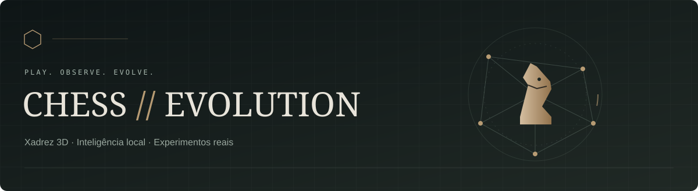
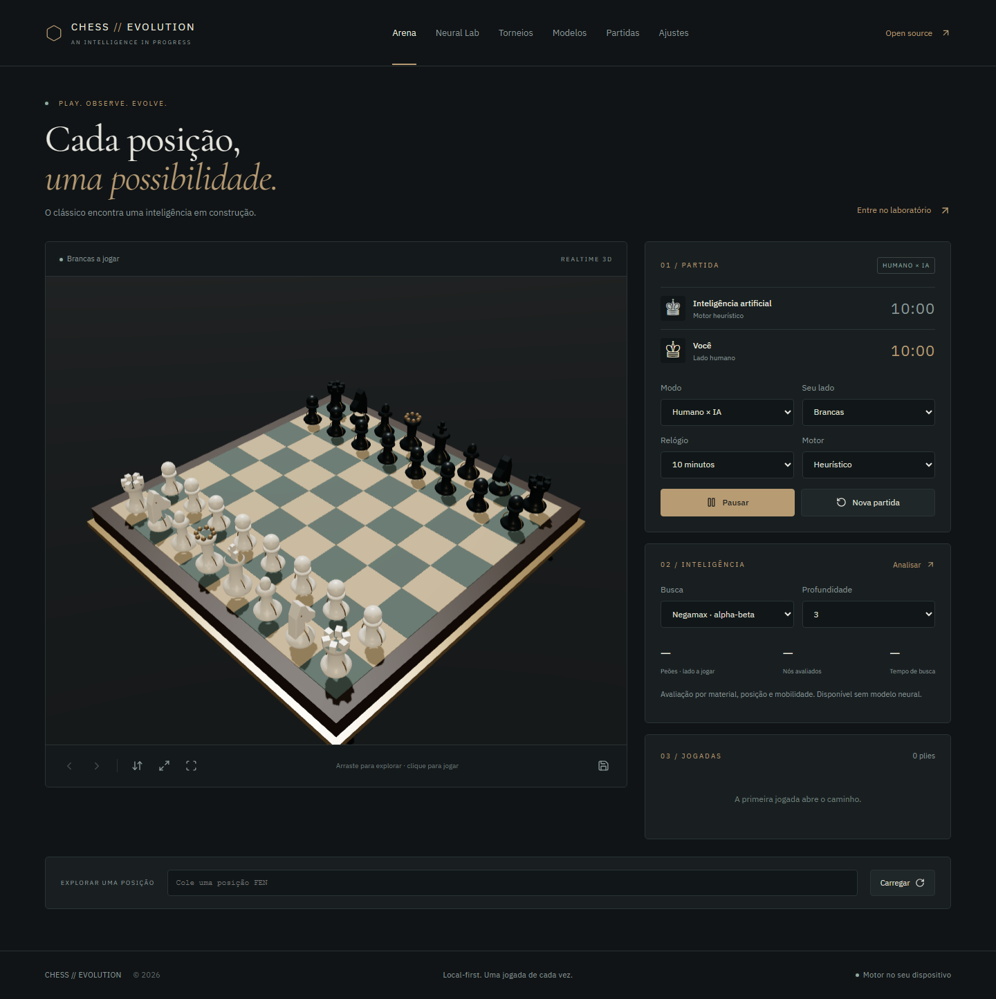

<p align="center"></p>

<p align="center"><a href="https://chess-evolution.vercel.app">Jogar na Vercel</a> · <a href="docs/AI_DESIGN.md">Como a IA funciona</a> · <a href="docs/TRAINING.md">Guia de treinamento</a> · <a href="docs/IMPLEMENTATION_REPORT.md">Estado da implementação</a></p>

Xadrez 3D com motor heurístico, MCTS e um laboratório neural real no navegador. Crie uma rede, gere partidas de self-play, calcule gradientes e compare candidatas com uma referência. Sem Docker, serviço de IA pago ou servidor de treinamento obrigatório.



A evolução mais recente inclui animações, temas, relógios com incremento, replay, revisão calculada, exercícios e comparação de gerações. Veja o [relatório de evolução](docs/EVOLUTION_REPORT.md) para os testes e as capturas do build local. A publicação do código no GitHub foi autorizada em 10 de outubro de 2026; a implantação dessa versão na Vercel não foi verificada nesta etapa.

## O que funciona

- Tabuleiro procedural Three.js / React Three Fiber: peças esculpidas com curvas suaves, marfim/ébano, madeira, moldura arredondada, coordenadas, iluminação e reflexos de estúdio, sombras suaves, órbita, zoom, inversão, vista superior e perfis gráficos. Alternativa 2D com controles de teclado e fallback sem WebGL.
- Humano × IA, IA × IA e dois jogadores. Regras oficiais de movimento, roque, en passant, quatro promoções, xeque-mate, empates, relógios, desfazer/refazer, FEN e PGN.
- Negamax com alpha-beta, aprofundamento iterativo, quiescência, ordenação e tabela de transposição sensível ao histórico. MCTS/PUCT com máscara de ações legais e policy/value neural.
- CNN residual TensorFlow.js com presets Tiny, Standard e Research. Treinamento por Adam, losses calculadas, replay limitado, separação por partida, checkpoints com pesos/otimizador/hash SHA-256 e retomada consistente.
- Avaliação com cores alternadas e promoção conservadora por evidência competitiva. Nenhum modelo é chamado de forte por simplesmente reduzir a loss. Rollback para campeões anteriores validados.
- Torneio round-robin entre 2–4 modelos; classificação e PGNs de partidas efetivamente jogadas.
- IndexedDB para partidas, modelos, experimentos, torneios e recuperação da arena. Importação/exportação de modelos e PGNs. Aprendizado de partidas humanas somente com consentimento.
- API opcional de backup PostgreSQL/Prisma com sessão assinada, isolamento por proprietário, limites e validação. Desativada nesta implantação; o jogo local continua funcionando.

Veja a [lista completa de funcionalidades e resumão do projeto](docs/FEATURES.md), organizada por Arena, motores, treinamento, modelos, torneios, partidas e ajustes.

## Executar localmente

Node.js 22 ou superior. Não é preciso configurar variáveis para o modo local.

```bash
npm install
npm run dev
```

Abra `http://localhost:3000`.

```bash
npm run lint
npm run typecheck
npm test
npx playwright install chromium
npm run test:e2e
npm run build
npm start
```

O build gera o cliente Prisma; não se conecta a um banco nem aplica migrações. As fontes são locais e o modelo não baixa pesos de terceiros.

## Primeiro experimento

1. No **Neural Lab**, inicialize um modelo **Tiny**. Ele será marcado **sem treino**.
2. Para verificar o fluxo rapidamente: 2 partidas, 4 simulações, 8 meias-jogadas, 1 época, lote 8. Esse orçamento pequeno comprova execução, não força de jogo.
3. Inicie o treino. O worker gera PGNs, políticas de visitas e resultados, depois calcula gradientes e salva uma nova candidata.
4. Exporte o checkpoint em **Modelos**, recarregue a página e confira a persistência.
5. Avalie com um número par de partidas. São necessárias pelo menos 8, 60% dos pontos e limite inferior Wilson acima de 50% para promoção contra a referência adequada.

Partidas interrompidas pelo limite de jogadas são **empates adjudicados**, explicitamente registrados. Redes pequenas treinadas em poucos jogos podem jogar pior que o heurístico. Nenhum rating externo é prometido.

## Arquitetura e documentação

| Documento | Conteúdo |
| --- | --- |
| [FEATURES](docs/FEATURES.md) | Resumão, todas as funcionalidades e limites atuais |
| [EVOLUTION_REPORT](docs/EVOLUTION_REPORT.md) | Evolução local, evidências de verificação e instruções para testar |
| [ARCHITECTURE](docs/ARCHITECTURE.md) | UI, regras, workers, persistência e modo remoto |
| [AI_DESIGN](docs/AI_DESIGN.md) | Encoding, ações, buscas e arquitetura da rede |
| [TRAINING](docs/TRAINING.md) | Self-play, datasets, checkpoints, avaliação e limites |
| [DEPLOYMENT](docs/DEPLOYMENT.md) | Vercel, configuração opcional e migrações |
| [TESTING](docs/TESTING.md) | Cobertura, comandos e cenários reais |
| [IMPLEMENTATION_REPORT](docs/IMPLEMENTATION_REPORT.md) | Entregas, decisões, limitações e trabalho futuro |

## Privacidade e limites

Os dados locais pertencem à origem do site e ao navegador. Exportar é necessário para transferir **pesos** para outro dispositivo. A sessão remota opcional é uma identidade privada desse navegador, não um login entre dispositivos. O treinamento distribuído e WebGPU não estão habilitados. Veja o relatório antes de interpretar métricas ou resultados.

## Stack

Next.js App Router · React · TypeScript strict · Three.js · React Three Fiber · Drei · chess.js · TensorFlow.js Layers/CPU/WebGL · Zustand · IndexedDB/idb · Zod · Prisma/PostgreSQL opcional · Vitest · Playwright.

Criado por [Vitor Costa](https://github.com/Vitorcostalv). Licença MIT.
