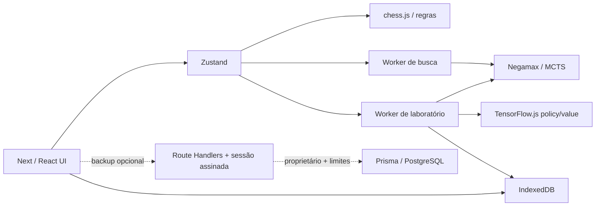

# Arquitetura

## Fronteiras

O servidor entrega páginas, assets e APIs de backup. A busca e o treino não dependem de funções Vercel prolongadas: executam em Web Workers do visitante, com mensagens tipadas. A UI não calcula gradientes nem roda loops de self-play.

## Diretórios

| Caminho | Responsabilidade |
| --- | --- |
| `src/app` | Arena, laboratório, modelos, jogos, torneios, ajustes, APIs |
| `src/components` | UI, 2D acessível e cena procedural 3D |
| `src/engine` | Regras, heurística, hashing, Negamax, MCTS |
| `src/ai` | Encoding, TensorFlow, geração de dados, promoção |
| `src/workers` | Protocolos, busca e sessões de laboratório |
| `src/services` | IndexedDB, validação, downloads, cliente worker, segurança remota |
| `src/stores` | Estado de arena, preferências e laboratório |
| `prisma` | Schema e migração PostgreSQL opcionais |
| `tests` | Regras, políticas, busca, rede, dados, persistência e E2E |

## Regras e concorrência

`chess.js` é a autoridade para movimentos. FEN descreve uma posição; PGN conserva o histórico necessário para repetição. A arena reconstrói o jogo a partir de posição inicial e PGN. O engine verifica que o PGN corresponde ao FEN solicitado. Nenhum movimento 3D é aceito sem passar por essas regras.

Uma revisão numérica muda a cada jogada, carga, desfazer ou alteração de modo. Resultados de buscas antigas não podem modificar a partida atual. O cliente cancela a busca encerrando seu worker, remove o timeout e ignora IDs divergentes. Workers pertencem à aplicação e são encerrados no descarregamento da página.

O laboratório mantém um único worker cooperativo: pause/cancel entram entre jogadas e lotes. Operações síncronas em execução precisam terminar antes de atender controle. Sessões têm limite de 10 minutos e 500 lotes; loops não crescem indefinidamente. Não há `setInterval` de simulação. O relógio da arena usa um timer leve de um segundo e é pausado na recuperação.

## Renderização

Geometrias Lathe e Extrude e materiais são compartilhados. Identidades de peças são derivadas do histórico, preservando instâncias ao mover, rocar ou promover. Animação interpolada respeita movimento reduzido. `frameloop="demand"`, DPR limitado e perfil baixo reduzem consumo. Recursos compartilhados são descartados no unmount. A câmera orbita, aproxima, inverte e muda para vista superior; a orientação padrão põe brancas no primeiro plano.

Uma checagem de WebGL e um boundary encaminham falhas para o tabuleiro 2D. As 64 casas 2D são botões com nomes acessíveis, acionáveis por Tab/Enter. Formas procedurais distinguem peão, torre, cavalo, bispo, dama e rei; não há dependência de modelos ou fontes remotos. Fontes UI são servidas pelo próprio site.

## Persistência e limites

IndexedDB `chess-evolution`, versão 4, migra incrementalmente `games`, `models`, `preferences`, `experiments`, `replay`, `tournaments`, `sessions`. Limites: 200 partidas, 32 modelos, 40 experimentos, 20 torneios, replay configurável até 4.096 posições. Logs/curvas são limitados por sessão. Quota ou indisponibilidade gera erro visível, sem fingir salvamento.

Cada checkpoint grava modelo **e cursor do experimento na mesma transação**. Em cancelamento, dados de lotes não confirmados são descartados e a sessão aponta para o último checkpoint durável. IDs de dataset e jogos de validação são preservados; retomar falha explicitamente se o replay necessário foi removido. Promoção/rollback também são transações.

A arena mantém um snapshot após mudanças. Na recuperação, valida o PGN/FEN, restaura a posição e pausa o relógio. Partidas concluídas são arquivadas automaticamente; salvar manualmente atualiza o mesmo ID, evitando duplicação.

## Remoto opcional

Ativado somente com `DATABASE_URL` e `AUTH_SECRET` de pelo menos 32 caracteres. Cookies assinados HMAC, HttpOnly, SameSite Strict, Secure em produção e TTL de 30 dias identificam um proprietário por navegador. Endpoints limitam payload, validam origem e usam quotas PostgreSQL atômicas. Consultas/atualizações/deleções sempre filtram proprietário. Pesos permanecem locais; SQL recebe PGNs e metadados, nunca blobs de tensores.

Esse modo é um backup de sessão, não uma conta com recuperação/email ou sincronização entre dispositivos. Sem variáveis, `/api/remote/status` declara desativado e o app local continua funcional. A implantação pública inicial não requer PostgreSQL.

## Decisões

CSS próprio e ícones Lucide foram suficientes para a interface, sem camada adicional de componentes ou Tailwind. Prisma permanece isolado do bundle cliente. TensorFlow usa módulos Core/Layers/CPU/WebGL, evitando ferramentas CLI/converter/data que a aplicação não usa. Não há Docker, Redis, processo residente nem orquestrador distribuído.
